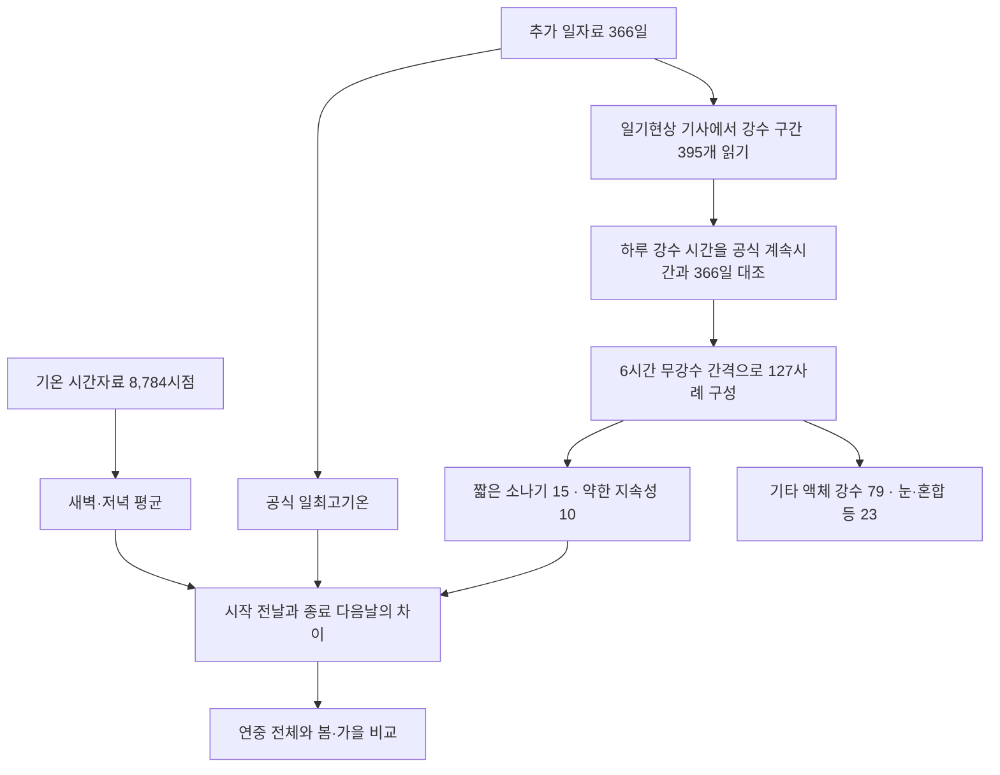
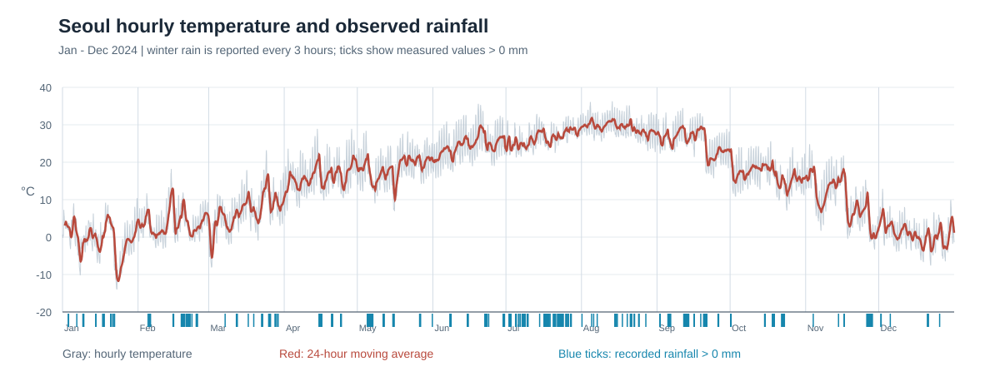
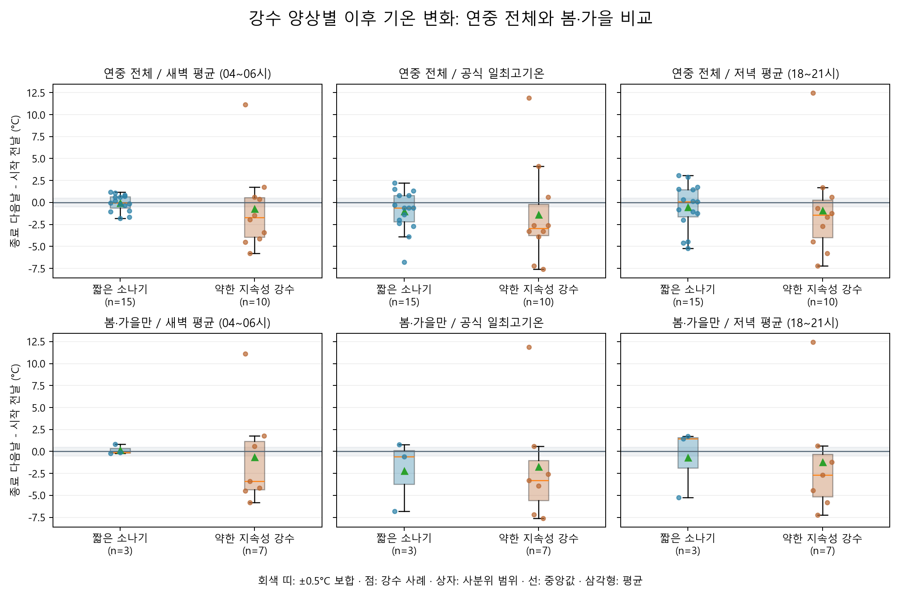
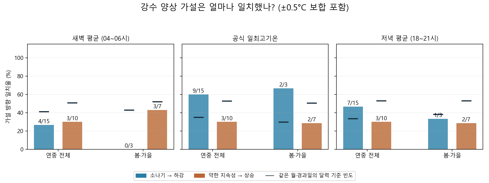
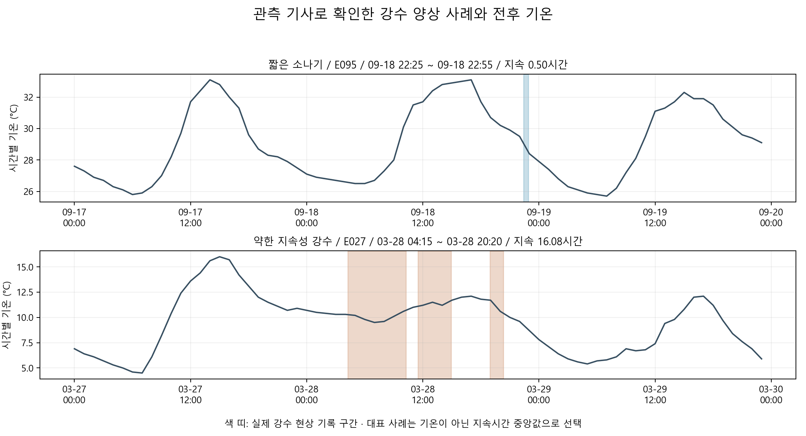

# 읽고 설명하기 위한 가이드

이 문서는 [최종 리포트](REPORT.md)를 이해하고 자기 말로 설명하기 위한 자료다. 제출 결과물의 본문은 리포트이고, 여기서는 분석 흐름·용어·계산·그래프 읽는 법을 풀어 쓴다. 수치와 그림은 현재 코드의 재계산 결과를 기준으로 한다.

처음에는 1~5장으로 질문·데이터·계산을 익힌 뒤, 8~11장에서 리포트 그림을 하나씩 읽는다. 발표를 준비할 때는 12~13장의 예문과 예상 질문을 참고하고 마지막 체크리스트를 직접 확인한다.

## 1. 먼저 기억할 핵심

**질문:** 짧은 소나기나 약하고 오래 오는 비의 양상만으로 다음날 기온의 상승·하강을 가늠할 수 있을까?

**실제로 한 일:** 서울의 2024년 관측 기사로 강수 양상을 분류한 뒤, 비가 시작되기 전날과 끝난 다음날의 새벽·최고·저녁 기온을 비교했다.

**결과:** 소나기 뒤 최고기온 하강은 15사례 중 9사례였지만 새벽·저녁까지 일관되지는 않았다. 약한 지속성 비 뒤 상승은 세 지표 모두 10사례 중 3사례였다. 현재 표본과 기준에서 안정적인 추론 근거는 충분하지 않았다.

**설명 범위:** 전선 이론을 배경으로 만든 가설을 관측 자료와 비교했다. 실제 전선과 구름 모양을 확인하거나 실시간 예보 시스템을 만든 것은 아니다.

## 2. 왜 이런 질문을 세웠나

교과서에서 한랭전선 뒤에는 찬 공기가, 온난전선 뒤에는 따뜻한 공기가 들어온다고 배운다. 강수 양상에도 차이가 있다면, 비를 관찰하는 것만으로 이후 기온 방향을 유추할 수 있을지 궁금해진다.

여기에는 두 단계가 있다.

```text
전선·기단 이동이라는 이론적 배경
       ↓
관측으로 구분한 강수 양상 ─── 이후 기온 방향과 얼마나 일치하는가?
```

이번에 직접 비교한 것은 마지막 줄이다. ‘소나기’를 관측했다고 한랭전선 통과로 확정하지 않는다. 온난전선에 의한 비인지 확인하지 않은 상태에서, 지속적인 비 뒤 기온이 내려갔다고 온난전선 이론이 틀렸다고 할 수도 없다. [전선의 기본 설명](https://www.metoffice.gov.uk/blog/2025/what-are-weather-fronts)

## 3. 데이터가 결과가 되기까지



### 8,784개인데 결과에는 왜 25개만 나오나

| 숫자 | 의미 |
|---:|---|
| 8,784 | 윤년 366일 × 24시간의 기온 시점 수 |
| 366 | 추가 일자료의 날짜 수 |
| 395 | 기사에서 읽은 강수 구간 수. 종류가 바뀌거나 자정을 넘으면 여러 구간이 될 수 있음 |
| 127 | 6시간 무강수 규칙으로 묶은 모든 강수 사례 수 |
| 25 | 두 핵심 분류에 해당하는 사례: 소나기 15개 + 약한 지속성 10개 |
| 3·7 | 봄·가을만 남긴 두 유형의 사례 수 |

과제의 ‘100개 이상 시계열 데이터’는 8,784시점·366일의 원본으로 충족한다. 그렇다고 기온 방향을 비교한 독립적인 강수 사례가 8,784개라는 뜻은 아니다. 핵심 비교 표본은 25개로 작다는 한계가 따로 남는다.

### ‘기사’는 뉴스 기사가 아니다

기상청의 일기현상 기사는 비·눈·소나기 등의 발생과 종료를 기록한 관측 메모다. 예를 들어 실제 2024년 9월 18일 기록은 다음과 같다.

```text
{소나기}2225-2255.
```

22시 25분에 소나기가 시작해 22시 55분에 끝났다는 뜻으로 읽는다. 중간에 `{비}{강도0}0900`처럼 나오면 그 시각의 현상과 관측 강도를 뜻하며, 매번 새로운 비가 시작됐다는 의미는 아니다. 강도 0·1·2는 약·중·강이다. [기상청 지상기상관측지침 10.5.1](https://data.kma.go.kr/resources/images/publication/%EC%A7%80%EC%83%81%EA%B8%B0%EC%83%81%EA%B4%80%EC%B8%A1%EC%A7%80%EC%B9%A8.pdf)

파싱한 하루 강수 시간을 별도 컬럼인 ‘강수 계속시간’과 대조했다. 366일 모두 허용 오차 0.011시간, 약 40초 이내로 맞았다. 이것은 **시간 해석의 검증**이며 모든 전선·구름 해석까지 맞았다는 검증은 아니다.

## 4. 분류 기준을 말로 설명하기

### 사례를 나누는 기준

비가 멈춘 뒤 6시간이 지나기 전에 다시 오면 같은 사례로 묶고, 6시간 이상 비가 없으면 새 사례로 본다. 자정이 됐다는 이유만으로 사례를 나누지 않는다.

### 두 유형의 기준

| 유형 | 조건 | 주의점 |
|---|---|---|
| 짧은 소나기 | 현상이 소나기로만 기록되고 전체 경과 시간이 3시간 이하 | 소나기라는 양상이지 반드시 많은 강수량이라는 뜻은 아님 |
| 약한 지속성 | 비·이슬비만 기록, 가장 긴 연속 구간이 6시간 이상, 기록된 강도가 적어도 하나 있고 모두 약(0) | 사례 전후에 짧은 중단이 있을 수 있고, 관측하지 않은 모든 순간까지 약했다고 보장하지 않음 |

두 기준에 맞지 않는 비도 실제 비다. 자료에서 지우지 않고 ‘기타 액체 강수’로 남겼다. 눈·진눈깨비·우박 등이 섞인 사례도 별도 분류했다. 분류에는 이후 기온을 쓰지 않았다. 기온이 내려간 사례를 보고 소나기라고 이름 붙이면 원하는 관계를 미리 만들어 버리기 때문이다.

3시간·6시간은 이번 분석의 **작업상 정의**다. 연구자가 비교를 위해 정한 규칙이며 공식 전선 판별 기준은 아니다.

## 5. 기온을 어떻게 비교했나

### 세 지표

| 지표 | 읽는 법 |
|---|---|
| 새벽 평균 | 04·05·06시 기온 3개의 평균. 순간 최저기온은 아님 |
| 공식 일최고기온 | 기상청이 제공한 하루 최고값. 발생 시각이 반드시 한낮인 것은 아님 |
| 저녁 평균 | 18·19·20·21시 기온 4개의 평균 |

매시간 기온 중 최고값은 시간 표본 사이에 발생한 더 높은 값을 놓칠 수 있다. 그래서 일최고기온은 일자료의 공식값을 따로 연결했다.

### 비교 날짜와 계산 예시

```text
3월 21일      3월 22일 오후 ~ 3월 23일 새벽       3월 24일
시작 전날           강수 사례                      종료 다음날
   └────────────────── 비교 ──────────────────────┘
```

이 경우 3월 24일의 최고기온에서 3월 21일의 최고기온을 뺀다. 강수가 며칠에 걸치면 비교일 사이의 간격도 길어진다. ‘끝난 다음날’과 ‘정확히 24시간 뒤’는 다른 기준이다.

설명용 가상 예시로 전날 새벽 평균이 10.0°C, 다음날 새벽 평균이 8.7°C라면 변화량은 `8.7 - 10.0 = -1.3°C`다.

| 변화량 | 분류 |
|---|---|
| -0.5°C보다 작음 | 하강 |
| -0.5~+0.5°C, 양쪽 경계 포함 | 보합 |
| +0.5°C보다 큼 | 상승 |

정확히 -0.5°C나 +0.5°C면 보합이다. 계산 코드도 같은 정밀도로 반올림한 뒤 경계를 비교한다. 이 기준은 미세한 차이를 크게 해석하지 않기 위한 규칙이며, 기상청의 공식 예보 판정 기준으로 제시한 것은 아니다.

기온에는 퍼센트 변화율보다 °C 차이를 사용했다. 섭씨 0°C는 절대적인 열에너지의 0이 아니고 음수도 있어서, 섭씨값을 분모로 한 변화율은 해석하기 어렵다.

## 6. 시계열 분석 용어

| 용어 | 쉬운 뜻 | 이번 분석의 예 |
|---|---|---|
| 시계열 | 시간 순서로 정렬된 관측값 | 시간별 서울 기온 |
| 데이터 포인트 | 특정 시각·날짜에 대응하는 한 관측 단위 | 1월 1일 04시의 기온 |
| 추세 | 정한 기간에서 이어지는 상승·하강 흐름 | 여러 날 동안 배경 기온이 오르는 흐름 |
| 계절성·주기성 | 일정한 간격으로 반복되는 구조 | 낮·밤 주기, 연중 여름·겨울 구조. 연간 반복 확인에는 여러 해가 필요 |
| 잡음 | 선택한 추세·주기로 설명되지 않는 변동 | 배경 흐름 주위의 시간별 출렁임. 무조건 측정 오류는 아님 |
| 이동평균 | 창을 한 칸씩 옮기며 계산한 평균 | 현재 시각과 앞선 23시간의 평균 |
| 집계 | 세부 관측값을 일정 기준으로 묶어 요약 | 04·05·06시를 새벽 평균 하나로 묶기 |
| 구간별 통계 | 조건별로 나눠 수치를 비교 | 강수 양상·계절·시간대별 중앙값과 일치율 |
| 결측 | 필요한 관측값을 알 수 없는 상태 | 품질 플래그가 결측을 뜻하는 빈 값 |
| 공란 | 파일에서 비어 있는 칸 | 의미 확인 전에는 결측·무강수로 단정하지 않음 |
| QC 플래그 | 관측 품질을 나타내는 코드 | 원본을 점검하는 보조 정보 |
| 이상치 | 다른 값들에서 크게 떨어진 값 | 큰 기온 변화. 실제 현상일 수 있어 자동 삭제하지 않음 |
| 파싱 | 규칙에 따라 문자열을 값·구조로 읽기 | `2225-2255`를 두 시각으로 바꾸기 |
| 전처리 | 분석 전에 자료를 정리하는 과정 | 날짜 정렬·중복 점검·자료 연결 |
| 민감도 분석 | 일부 조건을 바꿨을 때 결론이 유지되는지 살피기 | 다음날 재강수 사례를 제외한 비교 |

이번 과제의 분석 기법은 **24시간 이동평균, 전후 변화량, 양상·계절별 집계와 통계**로 2가지 이상이다. 이동평균을 그렸다고 추세·계절성 분해까지 수행한 것은 아니다.

## 7. 통계·해석 용어

| 용어 | 뜻과 주의점 |
|---|---|
| 표본·n | 실제 비교에 사용한 사례들·그 개수. `n=15`는 15사례 |
| 평균 | 합계를 개수로 나눈 값. 큰 값의 영향을 비교적 많이 받음 |
| 중앙값 | 정렬했을 때 가운데 값. 짝수 개면 가운데 두 값의 평균 |
| 분포 | 값들이 어디에 얼마나 모이고 퍼져 있는지 |
| 일치율 | 이번 가설이 예상한 방향과 맞은 사례 수 ÷ 전체 사례 수 |
| 퍼센트포인트(%p) | 두 비율의 차이. 60.0%와 34.2%의 차이는 25.8%p |
| 비교 기준·베이스라인 | 결과를 해석할 때 기준으로 삼는 간단한 방법·빈도 |
| 관찰 | 데이터에서 직접 확인한 사실. 예: 15개 중 9개에서 최고기온 하강 |
| 가설 | 아직 검증해야 할 설명·예상. 예: 기단 변화가 함께 나타났을 가능성 |
| 인과관계 | 한 요인을 바꾸면 다른 요인이 달라지는 원인 관계. 전후 순서만으로 증명되지 않음 |
| 교란 요인 | 함께 변해 관계 해석을 어렵게 만드는 요인 | 
| 일반화 | 관측한 표본의 결과를 다른 연도·지역에도 적용하는 것 |
| 통계적 유의성 | 통계 모형·가정에 따라 우연 변동과 구분하는 판단. 이번에는 유의성 검정을 수행하지 않았음 |
| 사후 분석 | 사건이 끝난 뒤 완성된 기록으로 살펴보는 분석 |
| 독립 기간 평가 | 규칙을 정할 때 사용하지 않은 기간에서 성능을 확인하는 것 |
| 미래 정보 누출 | 예측 시점에는 알 수 없던 정보를 평가에 사용하는 문제 |

이번의 교란 요인 후보에는 다음날 다른 비, 구름·일사, 계절, 기단 이동 등이 있다. 그것들이 이번 결과 차이의 원인이었다고 확정한 것은 아니다.

## 8. 그림 1 읽기: 연간 기온과 이동평균



**읽는 순서:** 가로축 날짜 → 세로축 °C → 회색 실제 기온 → 빨간 이동평균 → 범례.

- 회색의 짧은 톱니 모양은 시간별 변화다. 하루 안의 오르내림과 다른 기상 변화가 섞여 있다.
- 빨강은 24개 시간값을 평균해 출렁임을 줄인 선이다. 미래 예측선이 아니다.
- 여름 쪽이 높고 겨울 쪽이 낮다는 연중 구조를 볼 수 있다. 이 한 해만으로 장기 온난화 추세를 말할 수는 없다.
- 파란 짧은 선은 양수로 기록된 강수량 시각이다. **파란 선이 없다고 무강수라고 판단하면 안 된다.** 겨울 강수량의 제공 간격도 다르다.

설명 예문: “하루 안의 변동을 줄이려고 24시간 이동평균을 함께 그렸습니다. 배경 기온이 계절에 따라 크게 달라져 강수 사례를 계절별로도 비교했습니다.”

## 9. 그림 2 읽기: 상자그림과 사례 점



### 먼저 패널을 고른다

위쪽 행은 연중 전체, 아래쪽 행은 봄·가을만이다. 왼쪽부터 새벽·최고·저녁이다. 각 패널에서 파란색은 소나기, 갈색은 약한 지속성이다.

세로축은 **실제 기온 자체가 아니라 전후 기온 차이(°C)**다. 0보다 아래면 하강, 위면 상승이다. 회색 띠는 ±0.5°C 보합 구간이다.

### 점·상자·수염·삼각형

| 표시 | 의미 | 흔한 오해 |
|---|---|---|
| 작은 색 점 | 강수 사례 한 개의 기온 변화 | 서로 겹쳐 보일 수 있으므로 점의 눈대중 개수보다 `n`을 확인 |
| 점의 좌우 어긋남 | 겹침을 줄이기 위한 배치 | 시간 순서·별도 변수와 관계없음 |
| 상자 아래·위 경계 | Q1·Q3, 약 25·75% 위치 | 상자 높이는 표본 수를 뜻하지 않음 |
| 상자 안의 가로선 | 중앙값 | 모든 사례가 이 값이라는 뜻은 아님 |
| 초록 삼각형 | 평균 | 중앙값과 다르면 큰 값·분포 비대칭의 영향을 살핌 |
| 검은 수염 | Q1·Q3에서 IQR의 1.5배 범위 안에 있는 관측값까지 | 항상 최솟값·최댓값은 아님 |
| 수염 밖의 색 점 | 그 범위에서 멀리 떨어진 실제 사례 | 오류로 판단해 제거한 값이 아님 |
| `n=15` | 그 집단의 사례 수 | 15시간이나 15년이라는 뜻이 아님 |

`IQR = Q3 - Q1`이다. 상자는 가운데 약 절반의 분포를 요약한다. 표본이 3개뿐인 상자도 그릴 수 있지만 모양이 안정적인 모집단 분포를 보여준다고 해석하면 안 된다. [사용한 Matplotlib 3.10.8 상자그림 설명](https://matplotlib.org/3.10.8/api/_as_gen/matplotlib.pyplot.boxplot.html)

### 실제로 읽어 보기

위쪽 가운데 패널에서 소나기의 중앙값은 -0.60°C다. 15사례 중 절반의 경계를 나타내는 값이 하강 쪽에 있다는 뜻이다. 그러나 위쪽 왼쪽의 소나기 새벽 중앙값은 -0.03°C로 거의 변하지 않았다. 따라서 최고기온 결과만 보고 하루 전체가 시원해졌다고 말하면 안 된다.

갈색 집단에는 크게 상승한 점도 있다. 실제로 3월 22~23일 강수 사례 E025는 비교한 공식 최고기온이 +11.9°C 변했다. 이 값은 삭제하지 않았다. 집단 중앙값이 하강이어도 모든 사례가 하강한 것은 아니라는 설명에 쓸 수 있다.

## 10. 그림 3 읽기: 가설 방향 일치율



가로축은 연중·봄가을, 세로축은 비율(%)이다. 왼쪽부터 새벽·최고·저녁 패널이다.

- **파란 막대:** 소나기 뒤 하강한 비율.
- **갈색 막대:** 약한 지속성 강수 뒤 상승한 비율.
- **막대 위 `9/15`:** 전체 15사례 중 9사례가 가설 방향과 일치했다는 뜻.
- **검은 짧은 가로선:** 같은 월·같은 달력 경과일의 다른 날짜 쌍에서, 그 가설 방향이 나타난 평균 빈도.

색이 다르면 막대가 세는 방향도 다르다. **갈색이 낮다고 ‘기온이 적게 변했다’는 뜻은 아니다.** 상승 방향과 맞은 비율이 낮다는 뜻이고, 실제 변화 크기는 그림 2에서 읽는다.

예를 들어 연중 최고기온 패널의 파란 막대는 `9/15=60.0%`다. 검은 비교선은 34.2%다. 두 수치 차이는 후속 검증할 단서지만 통계적 유의성이나 실시간 예보 능력을 증명하지 않는다. 검은 선은 신뢰구간·오차 막대·p값도 아니다.

### 달력 비교선은 어떻게 만들었나

어떤 강수 사례가 같은 날 시작·종료됐다면 시작 전날과 종료 다음날은 이틀 간격이다. 같은 시작 월의 다른 날짜를 기준으로도 같은 이틀 간격의 기온 차이를 계산해 하강·상승 빈도를 구한다. 사례가 여러 날이면 그와 같은 경과일을 맞춘다. 비가 없는 날만 고른 대조군은 아니다.

이 비교선은 계절에 따른 자연스러운 변화 빈도를 살피는 **사후 참고 기준**이다. 실제 예측 모델을 학습해 별도 기간에서 얻은 정확도와 다르다.

보합도 분모에 포함한다. 봄·가을 새벽 소나기의 `0/3`은 하강이 0개라는 뜻이다. 실제 구성은 보합 2개·상승 1개이므로 세 사례가 모두 상승했다는 뜻은 아니다.

## 11. 그림 4 읽기: 실제 강수 구간과 기온



가로축은 각 사례 주변의 실제 날짜·시각, 세로축은 실제 시간별 기온이다. 선은 기온, 색 띠는 관측 기사가 확인한 강수 구간이다. 위는 소나기 E095, 아래는 약한 지속성 E027이다.

1. 제목의 시작·종료 시각을 읽는다.
2. 색 띠의 길이와 중단을 확인한다. 띠가 진하다고 강수량이 더 많다는 뜻은 아니다.
3. 비가 오기 전·오는 동안·그친 뒤 기온의 흐름을 살핀다.
4. 이 그림은 시간별 기온이므로 공식 일최고기온 수치와 정확히 같지 않을 수 있음을 기억한다.

두 패널은 세로축 범위가 다르다. 화면상 선의 기울기만으로 변화 크기를 비교하지 말고 눈금의 °C를 확인한다. 예시는 각 유형의 지속시간 중앙값에 가까운 사례로 골랐다. 무작위 대표 표본이나 가설이 잘 맞은 사례만을 뽑은 그림이 아니다. 이 두 장면만으로 전체 결론을 내리지 않는다.

## 12. 결과를 자기 말로 정리하는 순서

| 단계 | 설명할 내용 | 예문 |
|---|---|---|
| 질문 | 무엇을 알고 싶었나 | 강수 양상이 다음날 기온 방향의 단서가 되는지 궁금했다. |
| 방법 | 무엇을 어떻게 비교했나 | 기사로 양상을 분류하고 시작 전날·종료 다음날의 세 기온 지표를 비교했다. |
| 관찰 | 직접 확인한 숫자 | 소나기 뒤 최고기온은 15개 중 9개에서 0.5°C 넘게 내려갔다. |
| 해석 | 가능한 설명 | 시간대별로 다른 기상 요인이 작용했을 수 있지만 확인하지 못했다. |
| 한계 | 무엇이 아직 불명확한가 | 전선은 확인하지 않았고 사례 수가 작으며 다음날 재강수도 많았다. |
| 다음 단계 | 무엇을 더 확인할 것인가 | 일치·불일치 사례의 일기도를 대조하고 여러 해에서 반복 검증한다. |

‘유의미하다’는 말 대신 무엇을 의미하는지 구체적으로 설명한다. 예를 들어 ‘이번 표본에서 최고기온 하강 비율이 달력 기준보다 높았다’고 말할 수 있지만, 통계 검정을 하지 않았으므로 ‘통계적으로 유의한 예측력을 증명했다’고 말하면 안 된다.

### 발표용 짧은 설명 예문

> 저는 지구과학에서 배운 전선 이론을 바탕으로, 비의 양상만으로 다음날 기온 방향을 유추할 수 있는지 살펴봤습니다. 짧은 소나기 뒤에는 하강, 약하고 지속적인 비 뒤에는 상승할 것이라는 가설을 세웠습니다.
>
> 서울 2024년의 시간별 기온 8,784개와 일자료 366일을 사용했습니다. 강수량 공란을 임의로 채우는 대신 일기현상 기사로 강수 시각과 종류를 읽고, 계산한 시간을 공식 강수 계속시간과 대조했습니다. 기준에 맞는 소나기는 15사례, 약한 지속성 비는 10사례였습니다.
>
> 비가 시작되기 전날과 끝난 다음날의 새벽·최고·저녁 기온을 비교했습니다. 소나기 뒤 최고기온 하강은 60%였지만 새벽과 저녁에서는 일관되지 않았고, 지속성 비 뒤 상승도 30%였습니다. 봄·가을만 남기면 표본이 크게 줄었습니다.
>
> 이번 자료와 기준에서는 안정적인 추론 근거를 얻지 못했습니다. 실제 전선과 구름 모양을 확인하지 않았고 재강수도 많았기 때문에, 이 결과를 전선 이론의 반증으로 볼 수는 없습니다. 이후에는 잘 맞은 사례와 어긋난 사례의 일기도를 비교하고 여러 해로 확장하고 싶습니다.

예문은 읽은 뒤 자신의 표현으로 바꾸어 사용한다. AI가 코드를 도왔다는 사실과 실제 검증 범위도 함께 설명한다.

## 13. 예상 질문에 답하는 요점

| 질문 | 답변 요점 |
|---|---|
| 가설이 잘 안 맞으면 분석에 실패한 것인가? | 예상과 실제가 어디서 달랐는지 수치로 확인하고 한계를 설명한 것도 결과다. 과제는 가설을 반드시 맞히라고 요구하지 않는다. |
| 왜 원본은 100개 이상인데 사례는 25개인가? | 원본 시점 수와 분류 후 비교 사례 수가 다르다. 시계열 최소량은 충족하지만 표본이 작다는 한계는 남는다. |
| 왜 공란을 모두 0으로 채우지 않았나? | 공란의 의미가 확정되지 않았다. 강수 양상은 별도의 공식 기사와 계속시간으로 확인했다. |
| 왜 0mm인데 비가 왔다고 하나? | 실제 파일에 0mm와 비 기사·양수 계속시간이 함께 있다. 그래서 수량 0만으로 무강수를 판정하지 않았다. 정확한 강수량 표기 규칙까지 모두 해명했다고 주장하지 않는다. |
| 소나기면 한랭전선 아닌가? | 그런 연결을 가설의 배경으로 삼았지만 관측된 소나기만으로 전선을 확정하지 않았다. 전선 자료를 추가해야 한다. |
| 60%면 쓸 만한 예측 아닌가? | 사후 15사례의 일치율이고 새벽·저녁에서는 다르다. 다음날 재강수 12개를 제외하면 최고 하강은 1/3이며, 독립 예측 평가도 하지 않았다. |
| 왜 50%를 넘었는지만 보지 않나? | 계절에 따라 상승·하강·보합의 원래 빈도가 다르다. 그래서 같은 월·경과일 기준도 함께 봤다. |
| 겨울·여름을 빼니 좋아졌나? | 세 지표에 일관된 개선이 없었다. 기준에 맞는 겨울 사례가 없어 겨울 제외 효과를 따로 말할 수 없다. |
| 큰 상승값은 지워야 하나? | 큰 값만으로 오류라 판단하지 않았다. 원본과 날짜 연결을 확인하고 남겼다. |
| 비 때문에 기온이 바뀐다는 결론인가? | 강수 양상과 이후 방향의 일치를 본 분석이다. 다른 요인을 분리한 인과 분석은 아니다. |
| 이것은 실제 날씨 예보인가? | 완성된 기사로 돌아본 사례 분석이다. 예보 발표 시각에 알 수 있었던 정보만 쓰는 별도 평가가 필요하다. |
| AI는 어디에 사용했나? | 조회 보조·파싱·계산·시각화·해석 정리에 썼다. 원본 대조·독립 재계산·그림 및 수치 검증 방법은 리포트 AI 로그에 있다. |

## 14. 파일을 열어 확인하는 방법

| 알고 싶은 것 | 열 파일 |
|---|---|
| 최종 결과와 한계 | [REPORT.md](REPORT.md) |
| 요구사항 충족과 수정 기록 | [SUBMISSION_REVIEW.md](SUBMISSION_REVIEW.md) |
| 실행 순서·수집 방법 | [README.md](README.md) |
| 실제 설정 | [analysis_config.json](analysis_config.json) |
| 기사 원문·공식 최고기온 | [일자료 원본](data/raw/seoul_asos_daily_2024.csv), CP949 |
| 366일의 세 기온 지표 | [기온 가공표](data/processed/temperature_daily_2024.csv) |
| 사례별 종류·날짜·변화량 | [강수 사례표](data/processed/rain_episodes_2024.csv) |
| 일치율·중앙값·재강수 제외 결과 | [pattern_metrics.json](pattern_metrics.json) |
| 현재 핵심 코드 | [analysis_patterns.py](analysis_patterns.py) |

원본을 열어 저장할 때 인코딩이 바뀌면 재현에 문제가 생길 수 있다. 원본은 그대로 보존하고 가공표를 읽는 편이 편하다. 초기 탐색의 다른 예측 결과는 `docs/`에 보존되어 있으며 현재 핵심 양상 분석과 구분한다.

## 15. 제출 전 본인이 해볼 확인

- [ ] 질문과 두 가설을 자료를 보지 않고 설명할 수 있다.
- [ ] 8,784시점·127사례·25사례의 차이를 설명할 수 있다.
- [ ] 사례 CSV에서 E095를 찾아 시작·종료와 비교 날짜를 확인했다.
- [ ] 기온 가공표에서 그 비교일의 최고기온을 찾아 직접 뺄 수 있다.
- [ ] 9/15가 60%이고, 보합도 분모에 들어간다는 것을 설명할 수 있다.
- [ ] 상자 안 선과 초록 삼각형, 검은 비교선을 구분할 수 있다.
- [ ] 관찰 한 문장과 해석 한 문장을 따로 말할 수 있다.
- [ ] 가설과 잘 맞은 사례뿐 아니라 어긋난 사례도 설명할 수 있다.
- [ ] 현재 결과를 통계적 유의성·인과 증명·실시간 예보 정확도로 과장하지 않는다.
- [ ] AI 사용 범위와 검증 방법을 확인하고 최종 해석을 자신의 근거로 설명한다.

이 체크리스트는 학습자가 직접 확인할 항목이다. 자동 실행 검증이 통과했다는 이유만으로 본인의 설명 능력까지 검증된 것은 아니다.
