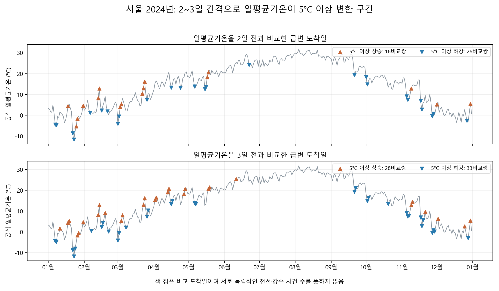
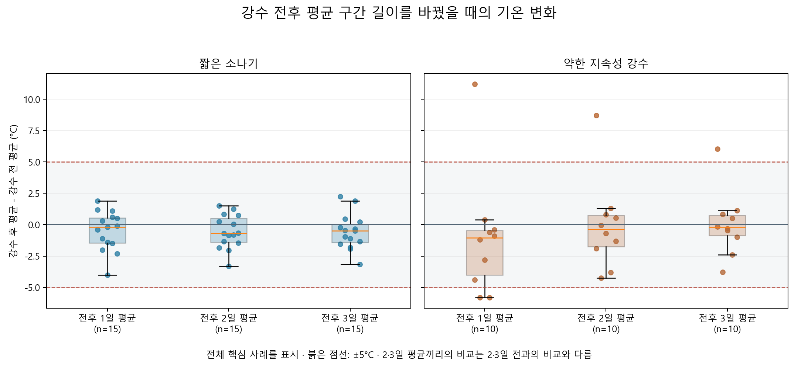

# 추가 탐색: 2~3일 사이 5°C 이상 급변할 때 가설의 징후가 있었나

**확인 결과:** 가설과 일치하는 사례가 있었다. 약한 지속성 강수 E025 뒤에 일평균기온이 3일 간격으로 **5.0→16.2°C(+11.2°C)** 변했다. 그러나 같은 유형의 강수 뒤 **-5.8°C** 변한 반대 사례도 두 개 있었다. 기존 짧은 소나기 15사례에서는 시작 전날~종료 다음날의 5°C 이상 급변이 확인되지 않았다.

이 문서는 서울 2024년 자료를 이용한 사후 추가 탐색이다. 원래 [강수 양상 분류](REPORT.md#41-강수-사례와-양상)를 유지하며, 급변 결과에 맞춰 소나기나 약한 비의 기준을 바꾸지 않았다.

## 1. ‘2~3일 평균기온 차이’의 두 가지 해석

| 구분 | 계산 | 의미 |
|---|---|---|
| A: 일평균의 2·3일 간격 차이 | `일평균기온(d) - 일평균기온(d-2 또는 d-3)` | 며칠 사이 하루의 평균적인 기온이 급변했는가? 주 분석 |
| B: 강수 전후 2·3일 평균끼리 비교 | `종료 뒤 2·3일의 평균 - 시작 전 2·3일의 평균` | 하루의 일시적인 변화가 아니라 며칠 평균에도 변화가 남는가? 보조 분석 |

두 계산은 다르므로 결과를 섞지 않았다. 공식 일자료의 `평균기온(°C)` 366개를 사용했다. 절댓값이 **5°C 이상**이면 급변으로 세며, 정확히 5°C도 포함한다. 원래 리포트의 새벽·최고·저녁 지표와도 별도다.

## 2. 전체 달력에서 찾은 급변 구간



| 범위 | 비교 간격 | 가능한 날짜 쌍 | 급변 날짜 쌍 | 상승 | 하강 |
|---|---:|---:|---:|---:|---:|
| 연중 | 2일 | 364 | 42 | 16 | 26 |
| 연중 | 3일 | 363 | 61 | 28 | 33 |
| 봄·가을 | 2일 | 179 | 23 | 8 | 15 |
| 봄·가을 | 3일 | 177 | 36 | 15 | 21 |

연중 42+61개의 비교쌍은 서로 겹친다. 두 간격 중 하나라도 기준을 넘은 **도착 날짜는 74일**이며, 이를 103개의 독립적인 날씨 사건이라고 세면 안 된다. 봄·가을은 비교일 양쪽이 같은 봄(3~5월) 또는 가을(9~11월)에 속하는 경우다.

### 이 구간에 강수 징후를 연결하는 기준

기준일의 하루 평균이 완성된 **다음날 00시 이후 시작해**, 급변 도착일 **00시까지 끝난** 기존 핵심 강수 사례만 연결했다. 즉 비교의 출발일 평균을 만드는 동안의 비나, 도착일에 새로 시작한 비를 선행 징후로 세지 않았다. 이는 시각상 순서를 맞추는 사후 기준이며 기록의 실제 제공 시각까지 검증한 것은 아니다.

2일 간격 급변 42쌍에는 이 조건을 충족한 핵심 두 유형이 없었다. 3일 간격 급변 61쌍에서는 가설 방향과 맞는 사례 1개(E025), 반대 사례 2개(E026·E031)가 연결됐다. 나머지는 **현재의 두 핵심 분류에 맞는 선행 사례가 없었다**는 뜻이다. 다른 비·눈이 없었다거나 전선이 없었다는 뜻은 아니다.

## 3. 기존 강수 사례를 기준으로 다시 확인

원래처럼 **강수 시작 전날과 종료 다음날의 일평균기온**을 비교하되, 두 날짜의 간격이 2일 또는 3일인 사례만 남겼다. 기존 약한 지속성 10개 중 E105는 4일 간격이어서 이 표에서는 제외한다.

| 범위 | 유형 | 2·3일 간격인 사례 | 5°C 이상 급변 | 가설과 일치 | 반대 방향 |
|---|---|---:|---:|---:|---:|
| 연중 | 짧은 소나기 | 15 | 0 | 0 | 0 |
| 연중 | 약한 지속성 | 9 | 3 | 1 | 2 |
| 봄·가을 | 짧은 소나기 | 3 | 0 | 0 | 0 |
| 봄·가을 | 약한 지속성 | 6 | 3 | 1 | 2 |

급변에 해당하는 세 사례는 모두 봄에 있었다. 원래 양상 분류와 시각을 유지한 결과다.

### 해당하는 세 사례 전체

| ID | 관측된 강수 기간 | 비교한 일평균기온 | 차이 | 가설 2와의 관계 |
|---|---|---|---:|---|
| E025 | 3/22 15:20~3/23 03:45 | 3/21 5.0°C → 3/24 16.2°C | +11.2°C | 약한 지속성 비 뒤 상승: 일치 |
| E026 | 3/25 12:55~3/26 10:25 | 3/24 16.2°C → 3/27 10.4°C | -5.8°C | 약한 지속성 비 뒤 하강: 반대 |
| E031 | 4/15 07:55~4/16 09:40 | 4/14 20.8°C → 4/17 15.0°C | -5.8°C | 약한 지속성 비 뒤 하강: 반대 |

세 사례 모두 첫 비교 도착일에 다른 강수는 기록되지 않았다. 하지만 실제 전선 유형은 확인하지 않아 ‘온난전선 통과 사례’라고 이름 붙일 수 없다. 특히 E025와 E026은 3월 24일을 공유하는 연속적인 기온 움직임이다. 세 사례를 서로 완전히 독립적인 검증으로 보지 않는다.

## 4. 전후 2·3일 평균으로 완화해도 남는가



이 그림은 **원래 핵심 25사례 전체**를 보여준다. 1일 평균 칸에도 4일 간격인 E105가 포함되어, 앞의 2·3일 간격 제한 표와 분모가 다르다. 각 점은 한 사례이고, 붉은 점선 밖은 5°C 이상 변화다. 2·3일 평균끼리 비교하면 실제 전후 날짜 전체의 범위는 2·3일보다 길어진다.

| ID | 전후 각 1일 | 전후 각 2일 평균 | 전후 각 3일 평균 |
|---|---:|---:|---:|
| E025 | +11.2°C | +8.7°C | +6.03°C |
| E026 | -5.8°C | -4.25°C | -3.77°C |
| E031 | -5.8°C | -3.8°C | -2.4°C |

전후 2일·3일 평균끼리 비교하면 5°C 이상인 핵심 사례는 E025 한 개만 남는다. 다른 두 사례도 하강 방향이지만 급변 기준 아래로 완화된다. 이를 ‘평균을 내면 가설이 더 잘 맞는다’고 해석하면 안 된다. 결과가 크게 나온 사례 한 개만 남은 것이며, 세 평균 길이에서 나온 E025는 세 개의 새 사례가 아니다.

E025의 강수 후 2일 평균은 3/24~25일, 3일 평균은 3/24~26일이다. 여기에는 다음 강수 사례 E026이 진행된 날짜도 포함된다. 따라서 평균 구간을 넓힌 결과 역시 E025만의 영향을 분리한 값이 아니다.

## 5. 해석과 한계

- **관찰:** 가설 2와 일치하는 큰 상승 사례는 존재하고, 전후 2·3일 평균에서도 +5°C 이상 상승이 남는다.
- **반례:** 동일하게 분류된 약한 지속성 비 뒤 큰 하강도 두 번 관찰됐다. 따라서 강수 양상만으로 큰 상승·하강을 구별하는 안정된 규칙은 확인되지 않았다.
- **가설 1의 범위:** 이번 소나기 표본에서는 정한 전후 기간에 5°C 이상 급변이 없었다. 이 결과를 소나기나 한랭전선이 급격한 하강과 무관하다는 증거로 일반화할 수 없다. 표본과 분류가 제한되어 있다.
- **표본 선택의 한계:** 급변이라는 결과를 먼저 고르고 돌아본 분석이다. 여기에서의 일치 건수는 전체 강수 사례의 예측 정확도가 아니다. 실제 전선·운량·바람·기압과 다른 날의 기온 흐름을 분리하지 못했다.
- **기록 시점의 한계:** 종료와 이후 6시간 무강수로 사례가 확정되며 완성된 일기사는 사후 제공된다. 사건 종료 시각이 도착일 전이라는 조건만으로 실시간 예측 입력의 가용성까지 보장하지 않는다.

후속 확인은 **E025·E026·E031의 일기도를 같은 기준으로 나란히 비교**하는 것이 적절하다. 잘 맞은 사례만 고르지 않고, 강수 양상이 비슷한데 기온 방향이 반대였던 이유를 확인할 수 있다. 현재 결론은 ‘급변 구간에서 가설과 맞는 징후는 있었지만 반대 사례도 있어, 단독 판단 기준으로 쓰기에는 근거가 부족하다’다.

## 6. 재현과 결과 파일

```powershell
python -X utf8 analysis_patterns.py
python -X utf8 analysis_rapid_changes.py
```

기존 분류와 공식 일평균기온을 사용한다. 설정은 [analysis_config.json](analysis_config.json)의 급변 기준·비교 간격 항목에 있다. 새 자료를 추정하거나 강수량 공란을 채우지 않았다.

- [계산 코드](analysis_rapid_changes.py)
- [전체 요약 및 세 사례 값](rapid_change_metrics.json)
- [급변 날짜 쌍 전체](data/processed/rapid_calendar_windows_2024.csv)
- [기존 사례의 전후 평균 비교 전체](data/processed/rapid_episode_comparisons_2024.csv)
- [기상청 일자료 원본](data/raw/seoul_asos_daily_2024.csv)

AI는 비교 정의의 대안을 확인하고 반복 계산을 재현하기 위해 정의 구체화·계산 코드·시각화·설명 정리에 사용했다. 원본에서 일평균 차이와 전후 평균을 다시 계산하고, 비교쌍 중복·선행 시각·일치와 반대 사례를 대조했다. 이 검증은 계산의 확인이며 실제 전선 통과나 인과관계를 검증한 것은 아니다.
