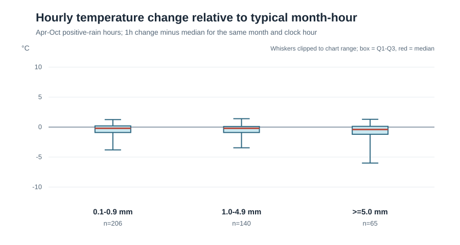
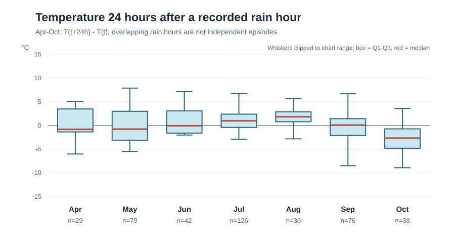
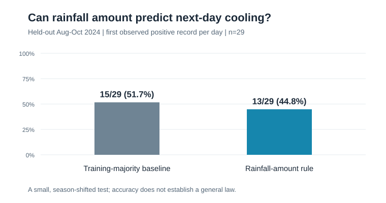

# 서울 2024년 강수 관측으로 이후 기온 방향을 가늠할 수 있는가

## 1. 분석 주제와 선정 이유

중·고등학교 지구과학에서 배운 기단·전선 이론을 출발점으로, **강수 관측이 이후 기온 방향을 가늠하는 단서가 되는지** 확인한다. 전선과 기단의 이동이 강수와 기온 변화에 함께 영향을 줄 수 있다는 것이 출발 가설이다. **강수 자체가 기온 변화를 일으킨다는 가설이 아니다.** 처음에는 장마와 여름철 비에 관심을 두고 6~9월을 검토했다. 한 계절만 보고 일반화하지 않도록 **2024년 전체**로 범위를 넓혔다. 연간 기온 흐름은 1~12월을 모두 사용한다.

강수 분석에는 관측 간격 차이가 있다. [기상청 자료 설명](https://data.kma.go.kr/data/grnd/selectAsosRltmList.do?pgmNo=36)은 **11월~3월 강수량을 3시간 간격**으로 제공한다고 밝힌다. 따라서 ‘시간당 강수 강도’와 그 시각의 기온 변화를 비교하는 주 분석은 **4~10월**로 한정했다. 겨울의 양수 강수 기록도 원본과 연간 그래프에는 남기되, 여름의 시간별 강수량과 같은 척도로 비교하지 않는다.

## 2. 분석 질문과 사전 가설

1. 2024년 서울 기온의 연간 흐름과 하루 주기는 무엇인가?
2. 4~10월에 강수량이 양수로 기록된 시각의 1시간 기온 변화는 강수 강도에 따라 다른가? **가설:** 강한 기록에서 하락 쪽 변화가 클 수 있다.
3. 4~10월의 양수 강수 기록으로부터 정확히 24시간 뒤 기온은 어떻게 달라지는가? 월마다 같은 방향인가? **가설:** 배경 계절과 기상 조건에 따라 달라질 수 있다.
4. 모든 양수 기록을 세는 방식과 날짜마다 마지막 양수 기록만 세는 방식에서 결과가 달라지는가?
5. 강수량 기록만으로 24시간 뒤 기온의 하강 여부를 예측하는 간단한 규칙이, 과거의 다수 방향만 따르는 기준보다 잘 맞는가? **가설:** 강수량이 전선 이동의 유용한 단서라면 별도 기간에서도 더 잘 맞을 수 있다.

## 3. 자료 설명·정제

- **출처:** [기상청 기상자료개방포털 ASOS 시간자료](https://data.kma.go.kr/data/grnd/selectAsosRltmList.do?pgmNo=36), 서울 관측소(108). 조회·다운로드일: 2026-10-27.
- **기간·크기:** 2024-01-01 00:00~2024-12-31 23:00, 한국표준시(KST). 윤년 366일에 해당하는 **8,784개 시간 시점**이 중복·누락 없이 이어진다.
- **원본:** [2024년 연간 CSV](data/raw/seoul_asos_hourly_2024.csv), CP949 인코딩. 열은 지점, 지점명, 일시, 기온(°C), 기온 QC플래그, 강수량(mm), 강수량 QC플래그다. 앞서 받은 [6~9월 CSV](data/raw/seoul_asos_hourly_2024-06_09.csv)의 2,928행은 연간 CSV의 같은 기간과 **전부 일치**했다.
- **기온:** 빈 값 0개. 범위는 -14.0~36.3°C이며 보간·삭제하지 않았다.
- **강수량:** 양수 **519시각**, 명시적 `0` **437시각**, 공란·QC `9` **1,732시각**, 공란·플래그 없음 **6,096시각**이다. 4~10월의 양수 기록은 **411시각·69일**이다. 기상청은 QC `9`를 **결측**으로 설명한다. 공란 전체를 `0`으로 채우지 않았으며 플래그 없는 공란의 의미도 확정하지 않았다.
- **이상치 기준:** 날짜 파싱 실패, 1시간 격자 누락·중복, 음수 강수량은 오류로 분리한다. 이번 자료에서 해당 오류는 없었다. 큰 강수량이나 급격한 기온 변화는 실제 기상 현상일 수 있으므로 크기만으로 제거하지 않았다. 숫자로 기록된 강수량의 범위는 0~39.0 mm다.

시간별 단위는 강수 기록 전후 1시간과 24시간 변화를 보기 위해 선택했다. **추세**는 여러 날에 걸친 배경 기온 흐름, **주기성**은 하루 시간대와 연중 월에 따른 반복 가능성, **잡음**은 이 흐름만으로 설명되지 않는 시간별 출렁임으로 구분한다. 2024년 한 번의 연간 주기만으로 ‘매년 같은 계절성이 반복된다’고 주장하지 않는다.

## 4. 분석 방법과 시각화

### 방법

- **24시간 이동평균:** 각 시각과 앞선 23시간의 기온 평균. 단기 출렁임을 완화해 연간 기온 흐름을 살핀다.
- **1시간 기온 변화:** `T(t)-T(t-1시간)`. 4~10월의 양수 강수 기록 시각만 분석한다. 같은 월·시각에 관측된 **전체 시간**의 1시간 변화 중앙값을 빼 하루 주기와 월별 차이를 일부 보정했다. 이 기준에는 비가 기록된 시간도 포함되므로 ‘무강수 대조군’은 아니다.
- **24시간 기온 변화:** `T(t+24시간)-T(t)`. 같은 시각끼리 비교해 하루 주기의 영향을 일부 줄인다. `t`는 **강수량 양수 기록 시각**이며, 비가 그친 시각이라고 단정하지 않는다.
- **강도 구간:** 4~10월에 기록된 강수량을 `0.1~0.9`, `1.0~4.9`, `5.0 mm 이상`으로 나눴다. 설명용 기준이지 전선·구름 유형 분류가 아니다. 같은 날 여러 기록은 독립 표본이 아니라는 점을 고려해 날짜별 마지막 양수 기록 1개를 택한 민감도 계산도 했다.
- **탐색적 예측 검증:** 4~10월의 각 날짜에서 **처음 확인된 양수 강수 기록** 하나만 선택한다. 그 시각에 이미 알 수 있는 **강수량 구간만** 사용해 24시간 뒤 기온이 더 낮은지(`T(t+24시간)<T(t)`) 예측한다. 4~7월 **40일**로 구간별 다수 방향을 정하고 8~10월 **29일**을 손대지 않은 평가 구간으로 둔다. 동률이면 학습 구간 전체의 다수 방향을 택한다. 비교 기준은 강수량 없이 학습 구간 전체의 다수 방향만 예측하는 규칙이다. 이는 현재 데이터의 **양수 강수 기록이 있는 날에 조건부로** 평가한 것으로, 비가 오지 않는 날을 구별하는 성능은 아니다.

### 연중 3시간 단위 통일 가능성

겨울의 제공 간격에 맞춰 **연중 모든 강수량을 3시간 단위로 맞추는 방법 자체는 가능하다.** 다만 4~10월의 시간별 강수량 3개를 합하려면 각 값이 숫자이거나, 공란이 무강수 `0`이라는 별도 근거가 필요하다. 3시간 종료시각을 `00·03·06·…·21시`로 맞추고 계절 경계를 넘는 구간을 제외해 점검한 결과, 4~10월 **1,711구간 중 160구간(9.4%)**만 세 시간 모두 숫자였다. **380구간**에는 QC `9`가 적어도 하나 있었고, 나머지 **1,171구간**에는 QC `9` 없이 공란이 있었다. 숫자 3개가 있는 구간만 쓰면 비가 숫자로 기록되는 상황에 표본이 쏠린다. 모든 공란을 임의로 `0`으로 채워 합치면 반대 방향의 오류가 생길 수 있다. 이는 **3시간 집계가 불가능하다는 증거가 아니라, 공란의 의미를 확인하기 전에는 신뢰할 만한 연중 집계가 어렵다는 판단**이다. 또 3시간으로 묶으면 비 시작 전후의 1시간 기온 변화는 식별할 수 없으므로 질문도 3시간 기온 변화로 바꿔야 한다.

### 그림 1. 2024년 기온의 흐름과 확인된 양수 강수 기록

회색은 시간별 기온, 빨강은 24시간 이동평균, 아래 파란 선은 양수 강수 기록이다. 파란 선이 없는 시각을 모두 무강수로 해석하지 않는다. 겨울에는 강수량 제공 간격이 다르므로 계절별 파란 선의 밀도를 강수 빈도의 직접 비교로 사용하지 않는다.

### 그림 2. 4~10월 양수 강수 강도와 1시간 기온 변화

같은 월·시각의 전형적인 변화량을 뺀 뒤 중앙값은 약한 구간 **-0.20°C(n=206)**, 중간 구간 **-0.20°C(n=140)**, 강한 구간 **-0.40°C(n=65)**다. 가장 강한 구간은 하락 쪽으로 더 치우쳤지만, 약한 구간과 중간 구간의 중앙값은 같다. 강도가 커질수록 냉각이 일정하게 커진다고 단정하지 않는다.

### 그림 3. 4~10월 양수 강수 기록에서 24시간 뒤의 기온 변화

월별 중앙값은 4월 **-0.80°C(n=29)**, 5월 **-0.75°C(n=70)**, 6월 **-0.05°C(n=42)**, 7월 **+1.00°C(n=126)**, 8월 **+1.85°C(n=30)**, 9월 **+0.10°C(n=76)**, 10월 **-2.65°C(n=38)**다. 같은 달 안의 분포도 넓다. 강수 기록 후 하루가 지나면 무조건 더 시원해진다는 예측은 이 자료에서 성립하지 않는다.

### 그림 4. 강수량만 사용한 다음날 기온 방향 예측

학습 구간(4~7월)에서는 40일 중 **22일**에 다음날 기온이 내려갔다. 그 다수 방향만 예측한 기준은 평가 구간(8~10월) **29일 중 15일(51.7%)**을 맞혔다. 같은 학습 자료로 정한 강수량 구간별 규칙은 **13일(44.8%)**을 맞혔다. 구간별 학습 표본도 각각 **21·15·4일**로, 가장 강한 구간이 특히 작다. 이 한 번의 연도·계절 분할에서는 강수량 값만 추가해 예측이 개선됐다고 말할 수 없다.

## 5. 인사이트: 관찰·해석·다음 검증

### 인사이트 1 — 연간 배경 기온과 하루 주기가 크다

- **관찰:** 월평균 기온은 1월 **-0.47°C**, 8월 **29.32°C**로 **29.79°C** 차이다. 연간 시각별 평균은 06시 **11.70°C**가 최저, 15시 **18.77°C**가 최고로 **7.07°C** 차이다.
- **해석(가설):** 강수 시각 전후의 원시 기온 차이만 보면 계절과 하루 주기를 강수와 혼동하기 쉽다. 같은 월·시각의 기준 변화량을 빼고, 24시간 뒤 같은 시각을 비교한 이유다.
- **다음 검증:** 다른 연도와 관측소에서도 같은 흐름이 재현되는지 확인한다.

### 인사이트 2 — 가장 강한 강수 기록 구간에서 동시간대 하락이 더 뚜렷하다

- **관찰:** 월·시각 보정 1시간 변화 중앙값은 `0.1~0.9 mm`와 `1.0~4.9 mm`에서 모두 **-0.20°C**, `5.0 mm 이상`에서는 **-0.40°C**다. 음수 비율은 각각 **55.3%(206시각), 62.9%(140시각), 69.2%(65시각)**다.
- **해석(가설):** 강한 비에 동반된 구름, 일사 감소, 바람·하강 기류 등이 기온 하락과 함께 나타났을 수 있다. **강수 자체가 기온 하락의 원인임을 증명하지는 않는다.** 비가 기록되기 전부터 하락이 시작됐을 수도 있다.
- **다음 검증:** 같은 시각의 일사·운량·풍향·기압과 강수 전 몇 시간의 변화까지 추가한다.

### 인사이트 3 — 24시간 뒤 변화는 월과 표본 단위에 민감하다

- **관찰:** 4~10월의 양수 강수 **411시각**에서 24시간 변화 중앙값은 **+0.40°C**, 하락 비율은 **45.5%**다. 4~5월과 10월은 월별 중앙값이 음수지만, 7~8월은 양수다. 날짜마다 마지막 양수 기록 하나씩 **69개**만 세면 중앙값이 **+1.20°C**, 하락 비율은 **27.5%**다.
- **해석(가설):** 다음날 기온은 배경 계절·기단·구름·일사와 다른 강수의 영향을 함께 받는다. 한 날에 연속된 강수 기록을 모두 세면 그 상황에 더 큰 가중치가 주어지는 것도 결과를 바꾼다. ‘비가 오면 다음날 시원하다’는 일반화는 적절하지 않다.
- **다음 검증:** 강수유무 자료로 실제 종료와 독립적인 강수 사례를 정의하고, 월·시각이 비슷한 비교 구간을 구성한다.

### 인사이트 4 — 강수량만으로는 평가 구간의 예측력이 확인되지 않았다

- **관찰:** 양수 강수 기록이 있었던 날짜를 하루 한 번만 세고 미래 기간을 따로 평가했을 때, 강수량 구간 규칙은 **13/29일(44.8%)**, 강수량을 쓰지 않는 다수 방향 기준은 **15/29일(51.7%)**을 맞혔다.
- **해석(가설):** 강수량 한 시점의 값만으로는 전선의 종류·이동 방향이나 배경 계절을 충분히 구별하기 어려울 수 있다. 이 결과는 **전선이 기온에 영향을 주지 않는다는 검증이 아니며**, 단지 이 자료와 규칙에서 예측 신호가 뚜렷하지 않았다는 뜻이다.
- **다음 검증:** 강수유무·지속시간·풍향·기압을 추가하고, 여러 연도에서 미래 기간을 반복 평가한다. 강수의 ‘형태’나 전선 유형은 현재 CSV에 없어 검증하지 못했다.

## 6. 결론과 한계

**결론:** 2024년 연간 자료로 계절과 하루 주기를 확인했다. 같은 간격의 4~10월 자료에서는 가장 강한 양수 강수 기록이 더 큰 동시간대 기온 하락과 함께 나타났지만, 하루 뒤 변화는 월과 표본 단위에 따라 달랐다. 별도 기간의 탐색적 평가에서는 **강수량만 사용한 24시간 뒤 기온 방향 규칙이 단순 기준을 넘지 못했다(13/29일 대 15/29일).** 현재 강수량 한 시점의 기록만으로 전선 이동을 읽거나 다음날 기온 방향을 안정적으로 예측한다는 근거는 얻지 못했다. 인과관계나 다른 연도의 예측 성능까지 판단한 결과는 아니다.

**자료 부족으로 판단할 수 없는 것:** 강수량 공란 **7,828시각**의 의미가 완전히 확정되지 않았다. QC `9`인 1,732시각은 결측으로 보존하고, 플래그 없는 공란 6,096시각도 임의로 무강수 처리하지 않았다. 따라서 실제 강수 시작·종료·지속시간, 강수 형태를 정하지 못한다. 전선 종류와 이동 방향, 구름 모양도 CSV에 없다. 즉 **이번 검증의 입력은 ‘강수 상태 전체’가 아니라 확인된 양수 강수량 한 값**이다. 같은 지점의 일강수량·강수유무·일기현상과 분석일기도를 추가해 대조해야 한다.

**자료가 더 있어도 남는 한계:** 풍향·기압·일기도가 추가되어도 단일 관측소의 전후 비교만으로 특정 전선의 인과 효과를 증명하기는 어렵다. 계절, 시간대, 일사, 다른 강수가 함께 변한다. 예측 평가도 **1년 중 29일**의 계절이 달라진 구간에서 한 번만 수행해 오차가 크다. 여러 연도·지역의 반복 평가와 비교 설계가 필요하다. 한 해로 연중 흐름은 묘사할 수 있지만 반복되는 계절성의 일반 법칙은 검증할 수 없다.

## 7. AI 사용 로그

| 사용 작업 | 사용 이유 | 검증 방법 |
|---|---|---|
| CSV 전처리·품질 점검 | 공란과 QC 플래그를 섞지 않고 반복 계산하기 위해 | 원본의 첫·끝 시각, 8,784행의 연속성, 상태별 건수 합계를 확인했다. 6~9월 원본 2,928행이 연간 CSV의 같은 기간과 일치함을 별도로 대조했다. |
| 지표 계산·SVG 시각화 | 같은 방법으로 수치와 그림을 재생성하기 위해 | `analysis.py`를 다시 실행하고 `metrics.json`의 표본 수·중앙값·평가 적중 건수를 리포트와 대조했다. 그림 4개를 렌더링해 축과 레이블을 확인했다. |
| 해석·문장 정리 | 관찰·가설·한계를 분리하기 위해 | 겨울 3시간 강수량을 시간당 강도 비교에서 제외하고, ‘강수 종료’·‘인과 효과’처럼 관측만으로 뒷받침되지 않는 주장은 결론에서 제외했다. |

## 8. 재현과 자료 이용

Python 3.10 이상에서 `python analysis.py`를 실행하면 `metrics.json`과 `images/`의 SVG 4개가 재생성된다. 표준 라이브러리만 사용한다. 원본은 기상청 포털에서 **서울(108), 2024-01-01 00시~2024-12-31 23시, 시간자료, 기온·강수량과 두 QC 플래그**를 지정해 받았다. 자료를 과제 저장소에 공개할 때 [기상청 출처와 공공누리 출처표시 조건](https://data.kma.go.kr/data/grnd/selectAsosRltmList.do?pgmNo=36)을 유지한다.
